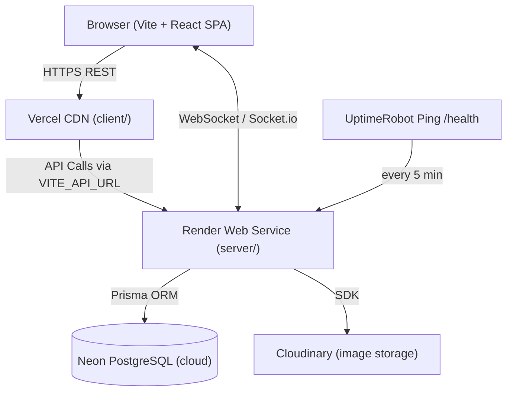
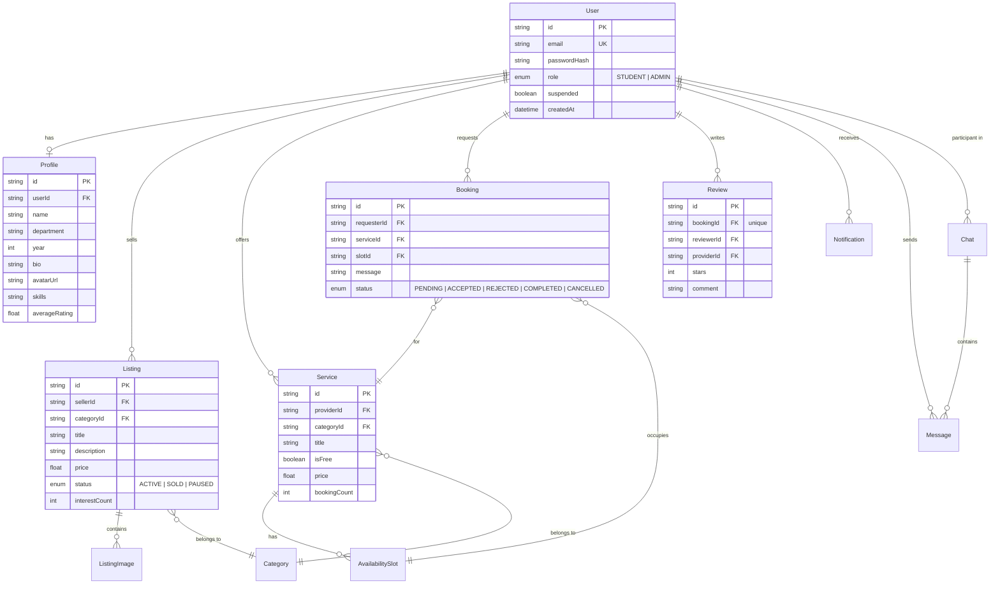

# CampusSphere - System Architecture & Technical Specifications

## 1. High-Level Architecture Overview

CampusSphere is a **monorepo** with two independent deployable units: a **Vite + React SPA** (frontend) and an **Express REST + WebSocket API** (backend), connected via HTTP and Socket.io. Both are containerized with Docker for consistent local and production environments.



---

## 2. Repository Structure (Monorepo)

```text
Campus-Sphere/                     # Monorepo root
├── .github/
│   └── workflows/
│       ├── ci.yml                 # Lint + build + tests on PR to dev/main
│       └── deploy.yml             # Auto-deploy to Render after CI passes on main
├── client/                        # Vite + React SPA (deployed to Vercel)
│   ├── public/
│   ├── src/
│   │   ├── api/                   # Axios instance + per-resource API functions
│   │   ├── components/            # Shared UI components (Navbar, Cards, Modals, etc.)
│   │   ├── hooks/                 # Custom hooks (useAuth, useSocket, useDebounce, etc.)
│   │   ├── pages/                 # Route-level page components
│   │   ├── context/               # AuthContext and other React Contexts
│   │   ├── store/                 # (Optional) Zustand global UI state
│   │   └── main.jsx / App.jsx     # App entry point and router setup
│   ├── .env.example               # VITE_API_URL
│   ├── Dockerfile                 # Multi-stage: build → nginx:alpine serve dist/
│   ├── nginx.conf                 # SPA fallback: try_files $uri /index.html
│   ├── index.html
│   ├── tailwind.config.js
│   ├── vite.config.js
│   └── package.json
├── server/                        # Express REST API (deployed to Render via Docker)
│   ├── prisma/
│   │   ├── schema.prisma          # All data models and enums
│   │   └── seed.js                # Seed categories, admin + demo students
│   ├── src/
│   │   ├── controllers/           # Business logic per domain
│   │   ├── routes/                # Express Router definitions
│   │   ├── middleware/            # verifyToken, requireRole, errorHandler, rateLimiter
│   │   ├── socket/                # Socket.io event handlers (chat, typing)
│   │   ├── helpers/               # notify(), cloudinary signing, etc.
│   │   └── index.js               # App entry: Express + Socket.io attach + listen
│   ├── .env.example               # DATABASE_URL, JWT_SECRET, CLIENT_URL, CLOUDINARY_*
│   ├── Dockerfile                 # Multi-stage: node:20-alpine → prisma generate → non-root
│   └── package.json
├── docs/                          # All project documentation
│   ├── Architecture.md
│   ├── Design.md
│   ├── memory.md
│   ├── Phases.md
│   ├── PRD.md
│   └── Rules.md
├── docker-compose.yml             # Local: db (postgres:16) + api + client (3 services)
└── README.md
```

---

## 3. Tech Stack

| Domain | Technology | Rationale |
| :--- | :--- | :--- |
| **Frontend Framework** | **Vite + React (JSX)** | Instant HMR, fast production builds, SPA routing with react-router-dom |
| **Styling** | **Tailwind CSS** | Utility-first; consistent with Design tokens in `Design.md` |
| **Data Fetching (client)** | **TanStack React Query + Axios** | Server-state caching, deduplication, optimistic updates |
| **Real-time (client)** | **socket.io-client** | Paired with server Socket.io for chat and live typing |
| **Backend Framework** | **Express.js (Node 20)** | Lightweight HTTP server, familiar middleware model |
| **Validation** | **Zod** | Shared schema definitions for API payloads |
| **Authentication** | **bcrypt + jsonwebtoken (JWT)** | Password hashing and stateless Bearer token auth |
| **ORM** | **Prisma** | Type-safe queries, declarative schema, built-in migrations |
| **Database** | **PostgreSQL via Neon** | Serverless cloud Postgres, free tier sufficient for dev |
| **Image Storage** | **Cloudinary** | Unsigned upload preset for direct browser → Cloudinary uploads; server only stores URLs |
| **Real-time (server)** | **Socket.io** | Attached to the same Express HTTP server; JWT auth in `io.use()` |
| **Security** | **helmet + compression + express-rate-limit** | Headers hardening, GZIP, and brute-force protection |
| **Containerization** | **Docker + docker-compose** | Reproducible local env; Render pulls the server Dockerfile on deploy |
| **CI/CD** | **GitHub Actions** | Lint → build → test → Prisma validate → Docker build → deploy hook |
| **Frontend Hosting** | **Vercel** | Zero-config Vite SPA deploy |
| **Backend Hosting** | **Render (Docker)** | Free tier Web Service running the server Dockerfile |
| **Uptime** | **UptimeRobot** | Pings `/health` every 5 min to minimize Render free-tier cold starts |

---

## 4. Data Models (Prisma Schema Entities)



---

## 5. API Endpoints Reference

| Method | Path | Auth | Description |
| :--- | :--- | :--- | :--- |
| `GET` | `/health` | None | Server health check |
| `POST` | `/api/auth/register` | None | Register with email + password |
| `POST` | `/api/auth/login` | None | Login, returns JWT |
| `GET` | `/api/auth/me` | Bearer | Current user info |
| `GET` | `/api/users/:id` | None | User profile + rating |
| `PUT` | `/api/users/:id` | Bearer (owner) | Update profile |
| `POST` | `/api/upload/sign` | Bearer | Cloudinary signature for browser upload |
| `GET/POST` | `/api/listings` | Bearer (POST) | Marketplace listings |
| `GET/PUT/DELETE` | `/api/listings/:id` | Bearer (PUT/DEL owner) | Listing detail/edit/delete |
| `GET/POST` | `/api/services` | Bearer (POST) | Services board |
| `GET/PUT/DELETE` | `/api/services/:id` | Bearer (PUT/DEL owner) | Service detail/edit/delete |
| `POST` | `/api/bookings` | Bearer | Create booking (transactional slot lock) |
| `PATCH` | `/api/bookings/:id/status` | Bearer | Accept/Reject/Complete/Cancel |
| `GET` | `/api/bookings` | Bearer | List sent/received bookings |
| `POST` | `/api/chats` | Bearer | Find or create chat |
| `GET` | `/api/chats` | Bearer | My chats with last message |
| `GET` | `/api/chats/:id/messages` | Bearer | Paginated message history |
| `POST` | `/api/reviews` | Bearer | Review a COMPLETED booking |
| `GET` | `/api/reviews/:userId` | None | Reviews for a user |
| `GET` | `/api/notifications` | Bearer | All notifications |
| `PATCH` | `/api/notifications/:id/read` | Bearer | Mark notification read |
| `GET` | `/api/discover` | None | Trending listings + suggested services |
| `GET` | `/api/categories` | None | All categories |
| `GET` | `/api/admin/stats` | Admin | Platform statistics |
| `GET/PATCH` | `/api/admin/users/:id` | Admin | Suspend / unsuspend users |
| `PATCH` | `/api/admin/listings/:id` | Admin | Remove listing |
| `PATCH` | `/api/admin/services/:id` | Admin | Remove service |

---

## 6. Security Architecture

1. **JWT Bearer Tokens**: Stateless auth; tokens stored in `localStorage` on client; verified via `Authorization: Bearer <token>` on every protected request.
2. **RBAC Middleware**: `verifyToken` → `requireRole('ADMIN')` chain guards admin-only routes.
3. **Helmet & CORS**: `helmet` sets secure HTTP headers; CORS restricted to `CLIENT_URL` env variable only.
4. **Rate Limiting**: `express-rate-limit` on `/api/auth/*` (e.g., 20 req / 15 min) to prevent brute-force attacks.
5. **Cloudinary Signing**: `CLOUDINARY_API_SECRET` never exposed to browser; client calls `/api/upload/sign` to get a time-limited signature.
6. **Input Validation**: All `POST`/`PUT` bodies validated with Zod before hitting the database.
7. **Error Leakage**: Central error handler hides stack traces when `NODE_ENV=production`; always returns `{ error, status, message }`.
8. **Transactional Integrity**: Booking slot-lock implemented inside a Prisma transaction to prevent race conditions.
9. **Admin Audit Log**: Every admin action (suspend/remove) written to an `AdminAction` table.
