# CampusSphere - Implementation Phases & Roadmap

> **Reference plan spans 10 days (19 Oct → 30 Oct).** Each phase maps to one or two calendar days and delivers independently testable value. Update `memory.md` as tasks are completed.

---

## Roadmap Overview

```mermaid
flowchart LR
    P1["Day 1\nSetup · DB · Docker"] --> P2["Day 2\nAuth · CI Pipeline"]
    P2 --> P3["Day 3\nDeploy Early · Profiles"]
    P3 --> P4["Day 4\nListings Backend · Hardening"]
    P4 --> P5["Day 5\nMarketplace UI · Services API"]
    P5 --> P6["Day 6\nServices UI · Booking API"]
    P6 --> P7["Day 7\nBooking UI · Chat Backend"]
    P7 --> P8["Day 8\nChat UI · Notifications · Home"]
    P8 --> P9["Day 9\nReviews · Admin · Tests"]
    P9 --> P10["Day 10\nPolish · Docs · Release"]
```

---

## Day 1 — Mon 19 Oct · Setup · Database · Docker
**Goal**: Working skeleton — monorepo, client, server, DB, and Docker all running locally.

- [ ] **#1** Create GitHub repo with `main` + `dev` branches; add README and Node `.gitignore`.
- [ ] **#2** `client/`: scaffold via `npm create vite@latest`; install `react-router-dom`, `@tanstack/react-query`, `axios`; set up Tailwind CSS; create `src/` folders `components/`, `pages/`, `hooks/`, `api/`; verify `npm run dev` opens.
- [ ] **#3** `server/`: `npm init -y`; install `express cors dotenv zod bcrypt jsonwebtoken helmet compression socket.io prisma @prisma/client`; create `src/routes/`, `src/controllers/`, `src/middleware/`; add `GET /health → {status:"ok"}`; verify in browser.
- [ ] **#4** Add ESLint + Prettier to both `client/` and `server/`; create `.env.example` in each with all variable names (`DATABASE_URL`, `JWT_SECRET`, `CLIENT_URL`, `CLOUDINARY_*`, `VITE_API_URL`) and no real values; confirm `.env` is in `.gitignore`.
- [ ] **#5** Create free Neon PostgreSQL project; paste connection string into `server/.env` as `DATABASE_URL`; run `npx prisma db pull` to confirm connectivity.
- [ ] **#6** Write `server/prisma/schema.prisma` with all models: `User`, `Profile`, `Category`, `Listing`, `ListingImage`, `Service`, `AvailabilitySlot`, `Booking`, `Chat`, `Message`, `Review`, `Notification`; add enums: `Role`, `BookingStatus`, `ListingStatus`, `MessageType`; define all `@relation` fields.
- [ ] **#7** Run `npx prisma migrate dev --name init`; write `prisma/seed.js` with 10 categories, 1 admin, 2 demo students (bcrypt-hashed passwords); run `npx prisma db seed`; verify in Prisma Studio.
- [ ] **#8** Write `server/Dockerfile` (multi-stage, `node:20-alpine`, non-root, CMD `prisma migrate deploy && node src/index.js`) and `client/Dockerfile` (stage 1: Vite build; stage 2: `nginx:alpine` serving `dist/` with SPA fallback); add `.dockerignore` to both.
- [ ] **#9** Create root `docker-compose.yml` with 3 services: `db` (`postgres:16` + volume + healthcheck), `api` (depends_on db healthy), `client` (port 5173→80); run `docker compose up --build`; confirm `/health` and SPA load; add run command to README.

**DoD**: `docker compose up` starts all 3 services; `/health` returns `{status:"ok"}`; Prisma Studio shows seeded rows.

---

## Day 2 — Tue 20 Oct · Auth · CI Pipeline
**Goal**: Full authentication flow (backend + frontend) and a green CI pipeline.

- [ ] **#10** `POST /api/auth/register` — Zod validation (email, password ≥ 8, name); bcrypt hash; create `User` + empty `Profile`; return JWT with `{id, role}`.
- [ ] **#11** `POST /api/auth/login` — bcrypt compare, return JWT; `GET /api/auth/me` — return current user. Return 401 for bad credentials.
- [ ] **#12** `verifyToken` middleware (reads Bearer token); `requireRole('ADMIN')` middleware; central error handler returning `{error, status, message}`. Test: no token → 401; student on admin route → 403.
- [ ] **#13** Build `/login` and `/register` pages — forms with validation messages and loading state; on success save token and redirect to home.
- [ ] **#14** `AuthContext` / `useAuth` hook (`user`, `login`, `logout`); store JWT in `localStorage`; Axios instance with `baseURL = VITE_API_URL` and an interceptor that adds `Authorization` header and auto-logs-out on 401.
- [ ] **#15** `ProtectedRoute` and `AdminRoute` components; Navbar showing Login/Register or Profile/Logout based on auth state; placeholder routes for all main pages.
- [ ] **#16** `.github/workflows/ci.yml` — triggers on PR to `dev` and `main`; jobs: install with npm cache, lint, build client. Open a PR and see green check.
- [ ] **#17** Extend CI: add `npx prisma validate`; add Postgres service container for tests; add `docker build` for both images (no push). Add status badge to README. Add branch protection on `main`: require CI pass.

**DoD**: Register → login → see protected dashboard works end-to-end. Every CI job passes on a test PR.

---

## Day 3 — Wed 21 Oct · Deploy Early · Profiles
**Goal**: Live deployment on Render + Vercel, CD pipeline, and user profile CRUD.

- [ ] **#18** Deploy backend: Render → New Web Service → GitHub repo → Root dir `server` → Runtime Docker → Free plan. Add all env vars. Verify `https://<your-api>.onrender.com/health`.
- [ ] **#19** Deploy frontend: Vercel → Import repo → Root dir `client` → add `VITE_API_URL`. Deploy. Set `CLIENT_URL` on Render to Vercel URL; fix CORS if needed.
- [ ] **#20** Test full login journey on live site. Fix any CORS/env errors now, before the codebase grows.
- [ ] **#21** CD pipeline: Create Render Deploy Hook URL → save as GitHub Secret `RENDER_DEPLOY_HOOK_URL` → `.github/workflows/deploy.yml` (on push to `main`, after CI: `curl -X POST $RENDER_DEPLOY_HOOK_URL`). Disable Render auto-deploy. Test by merging `dev` → `main`.
- [ ] **#22** Create UptimeRobot free monitor on `/health` every 5 min. Note expected cold-start delay in README.
- [ ] **#23** `GET /api/users/:id` (user + profile + rating placeholder); `PUT /api/users/:id` (name, department, year, bio, skills — owner-only, 403 otherwise).
- [ ] **#24** Build profile page (avatar, name, department, year, bio, skill tags) + Edit Profile form with validation and success/error toast. Use React Query `useMutation` and invalidate profile query on save.
- [ ] **#25** Cloudinary unsigned upload preset setup. Build `AvatarUpload` component: uploads directly to Cloudinary, saves returned URL to profile.

**DoD**: Live Vercel URL shows authenticated profile; avatar upload works; CD automatically deploys on `main` merge.

---

## Day 4 — Thu 22 Oct · Listings Backend · Hardening
**Goal**: Full listings CRUD API, image upload signing, and security middleware.

- [ ] **#26** `POST /api/listings`, `PUT /api/listings/:id`, `DELETE /api/listings/:id` — Zod validation; owner-only edit/delete.
- [ ] **#27** `GET /api/listings` with query params: `q`, `category`, `price_min`, `price_max`, `sort`, `page`, `limit` — returns `{items, total, page}`.
- [ ] **#28** `GET /api/listings/:id` (with images and seller info); `GET /api/categories`; increment `interest_count` when contact is triggered.
- [ ] **#29** `POST /api/upload/sign` — returns Cloudinary signature + timestamp. `CLOUDINARY_API_SECRET` stays server-side only.
- [ ] **#30** `ImageUploader` component — multi-image (max 4), file select, preview, remove, upload progress; returns array of URLs; saves as `ListingImage` rows on listing creation.
- [ ] **#31** Add `helmet`, `compression`, CORS allow-list (`CLIENT_URL` only), `express-rate-limit` on `/api/auth` (20 req / 15 min). Error handler hides stack traces in production.

**DoD**: All listing endpoints tested in Postman/Thunder Client. Rate-limiting and CORS verified. Image upload stores URL in DB.

---

## Day 5 — Fri 23 Oct · Marketplace UI · Services API
**Goal**: Full marketplace UI with search/filter and Services CRUD API with seed data.

- [ ] **#32** `ListingCard` (image, title, price, category badge, seller avatar) + responsive grid on `/marketplace` with skeleton loading; fetch with React Query.
- [ ] **#33** Search box, category chips, price range, sort dropdown; persist filter state in URL query string.
- [ ] **#34** Listing detail page: image carousel, description, price, seller card (links to profile), "Contact seller" button (wired in Day 8).
- [ ] **#35** Create / Edit listing form (title, description, price, category, condition + `ImageUploader`); same form reused for edit; on success invalidate listings query and navigate to detail.
- [ ] **#36** My Listings page: logged-in user's listings with edit, delete (with confirm dialog) and status; empty-state message.
- [ ] **#37** `POST /api/services` with `availabilitySlots` array — created in one Prisma transaction. `PUT`/`DELETE` with ownership check.
- [ ] **#38** `GET /api/services` (filter by category, free/paid, page); `GET /api/services/:id` with provider info and only unbooked slots.
- [ ] **#39** Add 5–6 sample services to `seed.js` (e.g., Python tutoring, resume review, guitar lessons) with slots so demo is not empty.

**DoD**: Marketplace shows listings with working filters. Services endpoints return correctly filtered data. Seed produces visible data.

---

## Day 6 — Mon 26 Oct · Services UI · Booking API
**Goal**: Services discovery UI and transactional booking system.

- [ ] **#40** `ServiceCard` (provider, price / Free badge, rating) + `/services` page with category and free/paid filters.
- [ ] **#41** Service detail page: description, provider card, list of open slots (date + time) with "Book" button per slot.
- [ ] **#42** Create Service form (title, description, category, free/paid toggle, price, slot picker with date + start + end rows); My Services page for edit/delete/pause.
- [ ] **#43** `POST /api/bookings {serviceId, slotId, message}` — Prisma transaction: check slot free → create `PENDING` booking → mark slot booked. Block self-booking. Return 409 if slot taken.
- [ ] **#44** `PATCH /api/bookings/:id/status` — rules: provider → `ACCEPT`/`REJECT`; provider → `COMPLETE` (after accept); requester → `CANCEL` (while pending). On reject/cancel, free the slot. Wrong user → 403.
- [ ] **#45** `GET /api/bookings?role=sent|received` — returns bookings with service, slot, and other user info, newest first.

**DoD**: Full booking lifecycle (create → accept → complete / cancel → reject) works via API. Slot double-booking returns 409.

---

## Day 7 — Tue 27 Oct · Booking UI · Chat Backend
**Goal**: Complete booking management UI and real-time chat backend via Socket.io.

- [ ] **#46** Booking request modal on service page: shows chosen slot, message box, submit; on success shows confirmation + link to Bookings page.
- [ ] **#47** Bookings page with two tabs: Sent and Received. `BookingCard` shows service, slot, other person, status.
- [ ] **#48** Color-coded `BookingStatusBadge`; provider sees Accept/Reject (and Complete after accept); requester sees Cancel. Invalidate bookings query after every action. Full-flow test with 2 demo accounts.
- [ ] **#49** Attach Socket.io to Express HTTP server; authenticate in `io.use()` by verifying JWT from handshake; set CORS to `CLIENT_URL`.
- [ ] **#50** Socket events: `join_room(chatId)` (check participant), `send_message` (Prisma save → emit `receive_message`), `typing_start`, `typing_stop`.
- [ ] **#51** `POST /api/chats` (find or create between 2 users, optional `listingId`/`serviceId`); `GET /api/chats` (my chats + last message); `GET /api/chats/:id/messages` (paginated).

**DoD**: Booking UI covers full lifecycle. Two accounts can exchange real-time Socket.io messages.

---

## Day 8 — Wed 28 Oct · Chat UI · Notifications · Home
**Goal**: Working chat inbox, real-time typing, notification bell, and home discovery page.

- [ ] **#52** `useSocket` hook (connect with token, auto-reconnect). Chat Inbox listing conversations with last message and timestamp. Wire "Contact seller" to `POST /api/chats`.
- [ ] **#53** Chat room: message list (my vs their bubbles), input box, send on Enter, auto-scroll, load history from REST on open.
- [ ] **#54** Typing indicator ("X is typing...") via typing events. Two-browser test: messages, refresh, reconnect.
- [ ] **#55** `notify(userId, type, text)` server helper. Call on: new booking request, accept/reject, new message, new review. Endpoints: `GET /api/notifications`, `PATCH /api/notifications/:id/read`.
- [ ] **#56** Notification bell in Navbar with unread count (`refetchInterval: 30000`). Notifications page with read/unread styling; click marks read and navigates to related resource.
- [ ] **#57** `GET /api/discover` — returns trending listings (by `interest_count`), suggested services (by `booking_count`), newest listings and services (6–10 items each).
- [ ] **#58** Home page: hero section, category chip row, Trending, Suggested Services, New Arrivals sections — all with skeleton loaders.

**DoD**: Real-time chat works between two accounts. Notification bell updates. Home page shows categorized discovery feeds.

---

## Day 9 — Thu 29 Oct · Reviews · Admin · Tests
**Goal**: Review system, admin dashboard, and automated test suite running in CI.

- [ ] **#59** `POST /api/reviews` — only for `COMPLETED` booking, only by requester, one review per booking; Prisma transaction saves review and recalculates provider `average_rating`; sends notification to provider.
- [ ] **#60** `StarRating` component; `ReviewForm` shown on completed bookings; review list + average stars on profile and service cards.
- [ ] **#61** Admin-only routes: `GET /api/admin/stats` (counts), `GET /api/admin/users`, `PATCH /api/admin/users/:id` (suspend/unsuspend), `PATCH` listing/service (remove). Write every action to `AdminAction` table. Suspended users cannot log in.
- [ ] **#62** Admin dashboard UI: stat cards (users, listings, services, bookings) + Users and Listings tables with action buttons. Guarded by `AdminRoute`.
- [ ] **#63** Set up Vitest/Jest + Supertest with test database. Test: register, login, wrong password, protected route → 401, admin route → 403.
- [ ] **#64** Test bookings: slot locks on create, double-booking → 409, only provider can accept. Ensure tests run in CI workflow and pass.

**DoD**: Reviews post correctly; admin can suspend users and remove content; CI tests pass green on a PR.

---

## Day 10 — Fri 30 Oct · Polish · Docs · Release
**Goal**: Production-ready polish, full documentation, and public release.

- [ ] **#65** Responsive check at 375px (Chrome DevTools). Fix overflow, tables (horizontal scroll), modals, and mobile Navbar menu.
- [ ] **#66** Every list has loading skeleton + empty-state message. Add global Error Boundary and toast for failed requests (no raw JSON visible to users).
- [ ] **#67** Write README: project description, live URL, screenshots, tech stack, features, local run steps, Docker run steps, env variables, CI/CD explanation, free-tier cold-start note.
- [ ] **#68** Add Mermaid architecture diagram and DB ER diagram to README. Add API endpoint table (or integrate Swagger via `swagger-ui-express`) in `/docs`.
- [ ] **#69** Full end-to-end journey on live URL: register → profile → listing → book → accept → chat → complete → review → admin. Fix any bugs found.
- [ ] **#70** Record 2–3 min demo video (Loom/OBS) of the full journey. Add GIF/screenshots to README. Merge `dev` → `main`, tag `v1.0.0`, publish GitHub Release. Share live link and repo.

**DoD**: App is publicly live, mobile-responsive, fully documented, and the GitHub Release is published.
